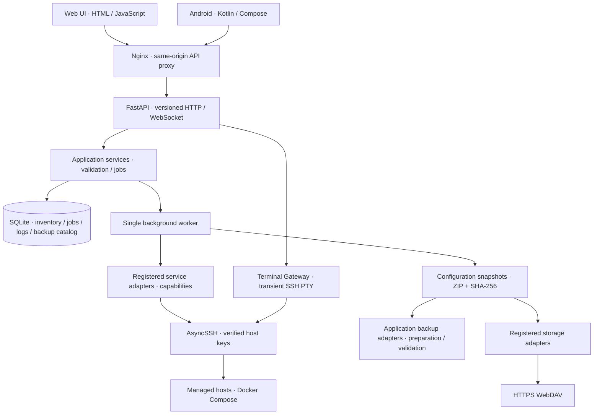

# Architecture · 0.4

## Runtime 0.3

[RUNTIME-0.3.md](RUNTIME-0.3.md) defines the delivered plugin/resource execution contract. Catalog discovery combines image-bundled generic definitions, GitHub metadata, and custom JSON documents; installed checksummed manifests provide capabilities. A fresh instance has zero installed plugins; upgrades preserve existing installations. Web and Android share central activation and durable resources/jobs.

## Ownership

The central Application layer runs on an administrator-controlled Docker host. Shared Application Services define functional parity between independently implemented clients; this follows the architectural principle discussed in SessionsFold.

## Repository map

| Location | Responsibility |
| --- | --- |
| `backend/unified/api.py` | HTTP routing, input schemas, authentication, protocol adapters |
| `application.py` | Use cases, inventory ownership, job creation and worker lifetime |
| `store.py` | SQLite schema v1, transactions, target lock, logs and crash recovery |
| `ssh.py` | Verified SSH connection, fixed Compose verbs, status parsing |
| `backups.py` | Shared bounded configuration ZIP policy, integrity, staging and restore |
| `adapters/` | Typed v1 contracts, explicit registry, Compose, backup applications, WebDAV and demo service implementation |
| `terminal.py` | Authenticated interactive shell sessions, PTY lifetime |
| `config.py`, `models.py` | Environment configuration and request validation |
| `web/api.js` | HTTP and WebSocket transport, session token |
| `web/theme.js`, `theme.css` | First-paint appearance, browser preference, system theme updates |
| `web/app.js`, `capabilities.js` | Web rendering, descriptor-driven forms/operations, view selection, polling |
| `android/app/src/main/java/dev/unified/app` | Native data models, transport, credentials, ViewModel, Compose UI |
| `prototype/` | Accepted standalone UI reference; never used as production backend |
| `docs/` | Architecture, deployment, protocol, parity and handoff |

## Plugin and adapter boundary

`plugins.py` owns catalog discovery, document validation/import/export, immutable installation and lifecycle. Uploaded documents are atomically saved under `/data/plugins/catalog/<id>/plugin.json`, independently of installed copies under `/data/plugins/packages`. Uploaded entries take precedence over builtins, GitHub entries and legacy definitions. Application serializes document writes with plugin lifecycle operations. Preview and import use the same validator; neither activates capabilities. Application constructs the active Registry from installed packages. Compose and common backup transports remain core primitives; Compose/command/npm adapters consume independently installed manifests. Compose descriptors bind each installed package ID, version, fields and operation subset; normalized host/directory identity keeps aliases under the same job lock. Generic Compose/npm/WebDAV definitions are image-bundled at `/builtin-plugins`. `plugin_catalog.py` owns the fixed official GitHub source, bounded HTTPS metadata/downloads, SHA-256 and metadata verification, and atomic cache writes under `/data/plugins/official`. Only metadata refreshes automatically (startup/six-hour loop); install/update materializes immutable executable manifests. No client connects to GitHub. The optional legacy `/plugin-catalog` mount imports modified definitions into data without overwriting user imports, while exact historical factory definitions are omitted. Installed registry activation remains explicit.

`resources.py` validates npm package names, scope, absolute executable paths and exact versions. Application resolves a requested version before queueing, locks installation identity and related hosts, and preserves observations on failed execution. Package installation and host binding are separate use cases. Commands bind values as quoted environment variables. Arbitrary administrator recipes run with the SSH account's authority.

Installed plugins cannot change while referenced work is queued/running. Jobs retain bound settings and version metadata. `job_sessions.py` receives input to a server-owned PTY; managed output is durable and diagnostic output is transient. The command's SSH exit status supplies completion evidence. A fresh shell starts on the same connection after command completion. See the runtime document for lifecycle limits.

## Client appearance

Clients present a compact server-name entry with a status dot. The details dialog shows address and connection state; editing credentials is an explicit second step. Connection failures have actionable banners and demo mode stays visible. Application-layer terminology is retained in architecture documentation/help rather than routine status chrome. Connection transports and automatic restoration remain unchanged.

Both clients offer light, dark and system appearance, defaulting to system. Web applies the preference before styles load and listens for OS and cross-tab changes; Android hoists the preference above navigation, stores it in dedicated SharedPreferences and observes the system configuration through Compose. Appearance stays local to each client and does not require an API or database field. Terminal output retains a dark, readable palette; surrounding controls use the selected theme. Android system bar icon contrast follows the resolved theme.

## Android adaptive workspace

Android 0.5.1 uses Material 3 Adaptive 1.3.0, Navigation 3 1.2.0 and NavigationSuiteScaffold. Navigation follows the actual window size/posture. Host and resource details are NavEntry destinations handled by ListDetailSceneStrategy. The strategy uses the content width after rail/insets: at least 664 dp enables two panes (320 dp each plus a 24 dp gap). Narrow windows show the selected detail with a back action. Hinge exclusions come from the library's window posture directive; device model names do not control layout.

Page, filters, selected IDs and list/console scroll positions use Compose saveable state. WorkspaceDrafts is owned by MainViewModel: resource/host forms, connection edits and unsent console input survive Activity recreation in memory. Drafts are excluded from saved-state bundles and diagnostics, cleared on the relevant close or workspace switch, and lost after process death. Resizing is presentation-only; it neither submits work nor replays terminal input. Plugin JSON editor state retains its existing saveable behavior.

AdaptiveWorkspace owns pane layout and navigation rendering; OverviewScreen owns selection and action forms. FormSpec owns its in-memory field values. Application API and server operations remain shared with Web. Target SDK remains 35; compile SDK 37.0 is required by the adaptive dependencies.

## Runtime decisions

- **Python 3.12 + FastAPI + AsyncSSH** keep networking and orchestration explicit and testable. The external system calls are isolated adapters.
- **SQLite** is sufficient for this single-administrator, single-worker instance. WAL supports concurrent UI reads. The partial unique index on active `target_key` enforces a persistent conflict boundary. A process file lock prevents two workers owning one data directory.
- **One worker, durable queue** keeps the first version predictable. Jobs are accepted with HTTP 202 and continue independently of client connections. Different targets may queue; duplicate active work on the same target returns 409.
- **Restart semantics** mark incomplete work failed/uncertain. SSH commands already sent to a host might have taken effect. The operator reads the logs and refreshes status before deciding to retry. No automatic replay.
- **Incremental log polling** uses a monotonically increasing cursor and a one-second client interval. Complete output is stored server-side. The log endpoint returns up to 1,000 chunks per request; clients catch up using `after`. An operation producing over 10 MiB of output fails explicitly. Full download streams from SQLite.
- **Separate Terminal Gateway** uses a WebSocket and SSH PTY. Job sessions use authenticated HTTP polling/input and have their own central lifetime. The first frame authenticates; tokens never appear in URLs. Current clients provide a line-oriented shell with Ctrl+C / Ctrl+D; they do not emulate a full ANSI screen. Sessions end with disconnect or 15 minutes of input inactivity. Terminal output is transient and separate from managed Job history.
- **Same-origin Web** is served by a separate Nginx service which proxies API and WebSockets. Native Android talks to that same HTTPS origin. No frontend CORS exception is needed.
- **No Docker socket mount.** Even `nas-host` service management goes through an explicitly configured SSH host account. The account must already have the intended Docker permissions.
- **Compose versions** are observed image identifiers. Upgrade pulls the image references specified by each host's Compose file and runs `up -d`. Automatic latest-tag discovery and editing remote Compose files are outside v0.1.
- **Configuration backups** archive `/sources/magpie` and `/sources/serverbox`. They are Unified-format snapshots, not parsers for every native Magpie or ServerBox export format. Application-specific storage locations must be confirmed during real deployment.

## Image release identity

Application and Web have independent numeric Docker release versions. A published tag identifies immutable image contents across deployment platforms. Packaging exports those existing images without rebuilding; changes require a new component tag. Compose uses a shared IMAGE_TAG, defaulting to latest; numeric tags provide explicit pinning. The publisher promotes latest only after both immutable component images are pushed. Historical naming mappings remain in release validation notes for existing installations.

## Container startup and storage

The Application image's entrypoint prepares DATA_DIR and SOURCE_DIR, initializes only root-owned empty directory roots with file descriptors, then execs the server via setpriv as UID/GID 10001. It clears supplementary groups and all inheritable, ambient and bounding capabilities, and sets no-new-privileges. Existing populated directories and other owners remain unchanged; there is no recursive ownership rewrite. SSH stays read-only and is not initialized by the entrypoint.

The image starts as root under Docker's standard capabilities solely for initialization; the running server has zero effective/permitted capabilities. An explicit non-root Docker user skips preparation, allowing operators to supply already-writable mounts. Compose has application and web only; init:true forwards signals/reaps children, and the exec chain delivers graceful shutdown to the server. Relative mounts resolve beside the Compose file. Existing paths must be retained during upgrades.

## Data and concurrency

Schema v1 stores inventory and backup catalog as validated JSON records, job envelopes in a separate table, and logs as append-only rows. The database also stores schema version and mode identity. A database created in demo mode cannot be opened in SSH mode.

The worker serializes operations. Inventory writes use transactions. Before future schema changes, add an explicit migration with backup and rollback instructions; the current version refuses unknown schema versions. There is no automatic cleanup: logs and archive rollback snapshots remain until the operator implements a deliberate retention policy.

Every SQLite transaction deterministically closes its connection. Recording a failed service job also invalidates the cached service state in that transaction, including shutdown and startup recovery paths.

The Android ViewModel owns mutations and selected details; UI polling follows the STARTED lifecycle. That same explicit observation entry point bootstraps the last saved connection after cold start/process recreation. A first installation only offers form defaults and does not automatically connect to demo. Foreground observation refreshes immediately; background cancellation closes an unaccepted connection candidate and resumes safely later. Network errors keep inventory/console state and retry read requests after five seconds. HTTP 401/403 pauses retries until settings are corrected. Connection errors are separate from operation errors and clear when reads recover. Workspace UI saveable state is keyed by server URL rather than connection-attempt count. No management operation or terminal input is replayed. A dead independent SSH socket requires a fresh terminal; a live central job session can be reattached through job history. The HTTP repository exposes suspending requests with cancellation. Tokens are encrypted using a non-exportable Android Keystore key; application backup is disabled. Web tokens are stored per origin in localStorage after a successful connection, with sessionStorage/memory fallback when persistent browser storage is unavailable. Existing session-only tokens migrate after successful verification. TLS validation is never bypassed.

Native client callbacks are scoped to their workspace and console generation. A late response from an earlier connection or reopened console cannot replace current state. Only a validated connection with successfully stored credentials becomes active. The client suppresses duplicate submissions while a request is in flight; the HTTP transport does not automatically retry operations.

## Restore boundaries

Archives contain `unified-manifest.json` and `payload/…`; the manifest declares format version and application name. Packing anchors file/directory opens to verified descriptors, rejects symlinks/special files and concurrent replacements, and bounds actual bytes read. Traversal is limited to 20,000 entries and 64 directory levels in addition to the 100 MiB / 10,000 file archive limit. Restoring verifies the catalog SHA-256, file count, expanded size, paths, duplicate entries, and symlink flags before replacing the destination. Existing settings are moved to a sibling `.unified-previous-<id>` directory, then staged settings are installed. A failed second rename restores the original directory. Power loss during the two-renames window requires operator recovery from that sibling directory; this is not a filesystem transaction spanning a power failure.

Restore requires a writable **parent** directory mount; bind-mounting the individual leaf directory prevents renaming. The application producing the configuration must be quiesced before backup or restore for a consistent snapshot. The first version does not orchestrate application-specific database dumps, service pauses, or file ownership translations.

## Reference documentation

- [FastAPI WebSockets](https://fastapi.tiangolo.com/advanced/websockets/)
- [AsyncSSH client and PTY APIs](https://asyncssh.readthedocs.io/en/latest/)
- [Android Compose state ownership](https://developer.android.com/develop/ui/compose/state)

## Plugin defaults · 0.4.5

Four service packages v1.1.0 provide Linux/systemd refresh, start, stop, restart, upgrade and doctor operations through existing descriptors. Web and Android use the same operations and fields; optional instance command overrides are under advanced settings and retain their values when collapsed. Nonempty instance commands take precedence over manifest commands; missing newly added settings receive manifest defaults. No new endpoint or schema version is introduced. See [PLUGIN-CATALOG.md](PLUGIN-CATALOG.md) for supported environments, legacy-template preservation and updates through JSON import. Android 0.4.5 carries the new form layout; Application 0.4.5 supplies the override/default semantics.
