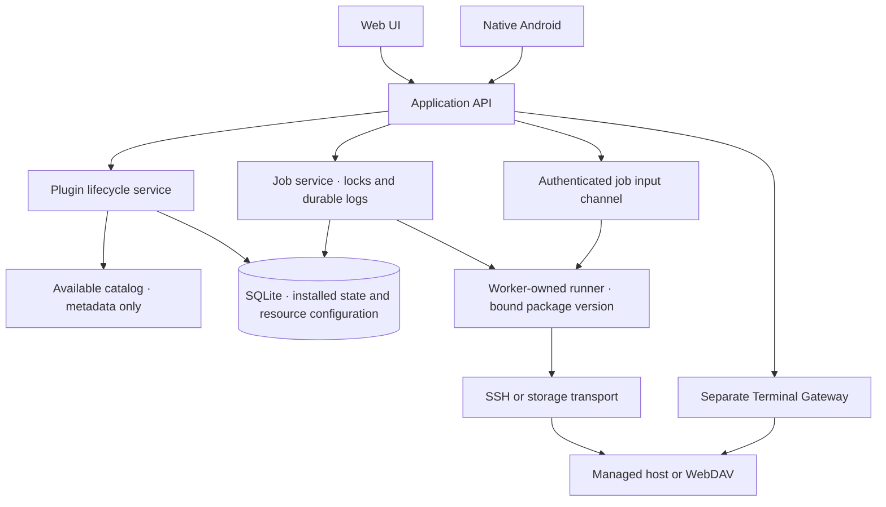

> 正式 0.3 实现与运行边界见 [RUNTIME-0.3.md](RUNTIME-0.3.md)。本文件保留完整目标设计。

# Unified 下一版设计 — Plugin 接入与交互任务

状态：供 Review 的实现设计。需求依据为 [REQUIREMENTS.md](REQUIREMENTS.md)，插件产品规则见 [PLUGINS.md](PLUGINS.md)。本文件规定下一版的实现边界；线上 0.2.0 和现有 APK 的能力仍以交付记录为准。

互动预览：<https://manager.example.com/next/>。原版 `prototype/` 根页面保留。预览源码在 `prototype/next/`，完全使用 Mock，不执行 SSH、安装脚本或 WebDAV 请求。窄屏用于手机流程 Review，不代表原生 Android 已实现。

## 1. 使用者的完整路径

| 页面 | 主要操作 | 空状态或异常 |
| --- | --- | --- |
| 服务与工具 | 跨主机总览、搜索、过滤、新增实例、查看详情、发起操作 | 无插件时引导到插件；缺失插件的旧资源保留，禁止执行并给出修复入口 |
| 主机 | 新增主机、查看所管理资源、打开独立 SSH | 尚无主机时提供新增入口；不可达与已停止服务分别显示 |
| 插件 | 按四类浏览可安装／已安装，查看详情，Install、启用、停用、更新、移除 | 未安装不出现在实例选择器；不兼容／安装失败显示具体原因，不激活半成品 |
| 备份与还原 | 选择 Magpie／Flutter ServerBox、配置 WebDAV、创建备份、确认目标后还原 | 分别提示缺失的应用插件、存储插件或目的地配置 |
| 执行记录 | 查看排队、运行、等待输入及最终结果，重开 Console、下载完整日志 | 失败保留错误，不自动重试；旧任务只查看，不恢复已结束进程 |

侧栏在手机上变成底部导航。服务详情、插件详情和 Console 在手机上使用大面板；输入行保持可见并适配键盘。桌面可用宽表格，手机用卡片。两端的动作、参数、错误原因与确认条件相同。

首次启动为零插件、零自动连接。用户先选择需要的插件，安装后新增主机与实例。已有 0.2.0 数据迁移后保留，相关插件仍需明确安装。

## 2. 首批对象及配置方式

- OpenCode、OpenChamber、Hermes、ChatGPT：分别提供应用插件，明确实现状态查询、升级、重启、启动、停止。每个插件独立确认软件来源、安装方式、运行用户和更新方法；尚未实现的动作列为缺口。
- halogen service、android-test-env、xpu-mode、zentune：进入接入跟踪，优先使用通用服务／工具插件的实例配置。名字本身不决定其命令。常驻服务定义生命周期；一次性工具定义操作名和参数。
- Magpie、Flutter ServerBox：各自的应用备份插件负责来源配置、格式及应用准备／校验步骤。WebDAV 是独立存储插件。
- Docker Compose：提供按项目目录管理的可选插件。中央部署方式与目标软件的管理方式分别配置。

新增实例分三步：选择已安装插件 → 选择主机和执行身份 → 填写插件声明的配置。通用插件允许维护命令或脚本、工作目录、超时、动作和参数。新增普通工具不要求编写程序或重建映像。

动作参数第一版支持字符串、整数、布尔值及单选项，提供 required、默认值、长度／范围与枚举约束。客户端按声明展示；中央再次校验。凭证使用独立 secret reference，不作为普通表单默认值返回。配置保存生成 revision；已提交任务绑定该 revision。

## 3. 所有权与运行边界

保留 `application.py` 的用例入口、SQLite 和单 worker。HTTP 层只处理认证、协议和输入格式。插件生命周期服务负责套件验证与安装状态；runner 负责动作执行。共享的锁、日志上限、超时、失败恢复及备份完整性校验由核心控制，插件不得绕过。

第一版同一数据目录只有一个 worker，同时执行一个受管任务；后续任务进入队列。任务等待输入时仍占用执行位置，UI 明确显示后续任务排队。客户端关闭 Console 不会释放锁或重新启动任务。独立 SSH 工作阶段可用于排错，但不代表受管队列已解除阻塞。

## 4. Package 与 runner 契约

每个插件使用 `plugins/<category>/<id>/`，包含 `plugin.yaml`、README、LICENSE、实现脚本及 fixture。构建产生独立的版本化 archive。可安装 catalog 与安装目录分开，扫描目录只读取有大小限制的 manifest，绝不导入或执行插件代码。

Manifest 的必要字段：

| 字段 | 语义 |
| --- | --- |
| `id`, `version`, `plugin_api` | 稳定 ID、套件版本、协议兼容范围 |
| `category`, `name`, `description`, `publisher` | 分类与显示信息；项目发布也需手动 Install |
| `runtime` | runner 类型与必要环境要求；不支持时阻止安装并说明 |
| `configuration` | 实例配置的字段 schema，含 secret reference 类型 |
| `actions` | 稳定 ID、名称、参数 schema、timeout、目标锁范围、交互模式 |
| `requirements` | 显式依赖及运行条件；安装页面列出，不自动安装 |
| `entrypoint` | 包内相对路径；路径验证后使用，禁止越界 |

通用命令插件负责参数绑定。API 触发操作只提交 action ID 和值；执行命令作为管理员保存的配置。参数通过结构化 argv、固定脚本参数或正确引用的变量传递，不对命令字符串做任意插值。SSH 层负责安全引用与主机密钥验证。凭证由中央在执行时解析，不放进套件。

执行器第一版采用核心提供的独立 runner 进程与固定协议。runner 通过独立控制通道传递 JSON 事件，受管程序的 stdout/stderr/stdin 使用各自的流，避免把程序输出误当控制信息。首批包只使用已声明的运行环境；带额外依赖的包必须明确声明独立执行环境，不能在核心进程里临时安装依赖。进程隔离本身不是安全沙箱。

提交给 runner 的上下文包括 job ID、目标标识、固定插件版本、配置 revision、action、已验证参数、期限和 transport 引用。结果事件包括 output、progress、input availability、可选的结构化 prompt、最终状态与状态／版本结果。输入内容不通过普通日志事件传递。

核心允许在包符合协议、环境兼容的情况下独立安装或更新。需要新增协议能力或核心运行环境的包应报告不兼容，而不是承诺任意代码都能免部署运行。

## 5. 安装、更新与数据保留

安装流程：用户选择 catalog 中的明确版本 → 显示来源、摘要、运行条件与依赖 → Install → 检查 archive、checksum、路径、大小与版本 → staging → 固化版本目录 → 事务提交安装状态 → 刷新两端能力。

校验失败不产生可执行能力。停用阻止新任务；有活动／排队引用时先阻止停用或移除，提示具体任务。移除只解除安装状态，保留实例、历史、备份和必要的版本文件。清理策略不在此版范围。

更新安装新版本并供未来任务使用。已运行与已排队任务保持提交时绑定的版本和配置；更新必须保留其引用版本。旧实例配置若无法迁移，新版本不得直接激活该实例。提供明确回退入口并保存旧版配置；不自动回滚已在目标主机上发生的软件升级。

包文件存在不等于已安装。中央数据库是安装状态的唯一依据，重启后重新读取。目录出错时资源可查看但操作不可用，不以默认插件替代。

## 6. Shell／PTY 交互与任务边界

Job Console 内嵌真实终端能力。中央 Terminal Session Manager 持有 SSH shell／PTY，worker 将声明的升级动作以前台程序运行。用户输入直接发送到该 PTY，支持普通键盘输入、Enter、Ctrl+C、Ctrl+D、终端尺寸变化及必要的终端转义序列显示；前端不把输入转换成固定回答按钮。第一版原生 Android 可采用独立终端组件，但必须实现相同交互。全屏 TUI 的具体兼容性须验证，不以行式 Mock 作为证据。

升级在前台时，输入由升级程序接收。升级成功、失败或被中断后，终端返回 shell 提示符，用户可直接执行诊断命令。不会自动向 shell 再次发送先前的输入。Job Console 清楚显示目标主机、账号、任务状态，以及“前台：升级程序／Shell 就绪／会话结束”。另开 SSH 提供额外的独立会话。

任务阶段为 `queued → running ↔ waiting_input → succeeded / failed / interrupted`。终端阶段独立为 `foreground → shell → closed`。waiting_input 仅来自结构化执行事件；没有该事件也不禁用运行中程序的输入。执行器通过独立控制通道报告实际退出状态，不能凭终端文字或 shell 提示符判断升级完成。程序退出只结束任务，PTY 的 shell 继续存在；进程崩溃或连接真正丢失时则显示会话结束／目标状态不确定。

升级退出时固定任务结果、版本及日志，释放 managed-job 目标锁和 worker 槽位。后续 shell 由 Terminal Session Manager 持有，不占用任务队列；手动命令不享有受管操作的锁与参数校验。UI 显示同主机的活动受管任务，防止用户把 shell 排错误解为队列中的受管动作。手动恢复成功也不把原本失败的升级任务改为成功；可另行刷新服务状态。

任务日志保存升级期间的输出。返回 shell 后使用单独的内存滚动缓冲，默认不持久化命令原文及排错输出；下载“任务日志”仅含原任务。密钥／管理员凭证优先使用中央引用；密码提示必须配合远端无回显，不能只靠客户端遮罩。原生终端组件应遵从回显模式，不替前台程序重复回显键盘输入。

所有终端输入经中央认证，并绑定 terminal session ID、session generation 和输入控制权。Web/Android 可同时查看，一次一个客户端持有输入控制权，接管需明确点击。每个输入消息有 request ID，服务端仅在该 session generation 内短期去重；不确定结果不自动重发。会话与任务分别检查生命周期：升级结束后的 live shell 可输入，closed session 和旧 generation 必须拒绝。

Ctrl+C 向当前前台进程组请求中断；升级退出后才记录 interrupted。在 shell 提示符按 Ctrl+C 仅清除当前输入，不修改历史任务。Ctrl+D 遵从目标程序的 EOF 语义；在空 shell 提示符通常退出 shell。模拟预览只演示这些结果，真实实现需 PTY fixture 验证。

收起面板、切换页面或暂时断网只 detach。重开 Console 时可重连仍存活的会话；“结束 Shell”或 exit 则关闭会话。在升级仍活动时，UI 要求先中断，或选择收起继续运行，避免把关闭面板误当取消任务。已完成历史任务若无存活会话，仅提供查看与明确另开 SSH，不重新执行升级。

升级总期限默认 30 分钟，插件可收紧；回到 shell 后改用 15 分钟空闲期限。关闭 session 会释放其传输与内存缓冲。中央重启使所有旧 session generation 失效：未完成升级标 interrupted，完成任务保持原结果，不自动重建 shell 或重放命令。

安全边界是既有单管理员认证、tailnet/TLS 访问、SSH 主机密钥验证和主机账号的实际权限。客户端通过中央代理操作，不拿到 SSH 私钥，不自动使用 root 或 sudo。受管操作依赖声明动作和参数验证；自由 shell 使用管理员已经配置的账号权限，保留其完整交互能力。

## 7. 下一版 API 轮廓

以下是待实现契约，沿用 `/api/v1` 基础路径。新增能力通过 `capabilities` 和协议版本声明，旧客户端不应猜测支持情况。正式实施时再更新 OpenAPI 与模型，避免把草案误报成线上接口。

| 操作 | 拟定接口 | 关键行为 |
| --- | --- | --- |
| 可安装 catalog | `GET /plugins/catalog` | 只读 metadata、指定版本、校验摘要、兼容性 |
| 已安装插件 | `GET /plugins` | 安装状态、活动版本、配置状态、引用数量 |
| 安装／更新 | `POST /plugins/installations` | 指定 ID、版本、catalog 摘要，返回安装任务，重复请求按 request ID 去重 |
| 停用／启用／移除 | `POST /plugins/{id}/lifecycle` | 明确 operation；有活动引用返回冲突 |
| 新增／调整实例 | `POST /services`, `PATCH /services/{id}` | 服务或工具、插件 ID、主机、配置及 revision 校验 |
| 发起操作 | `POST /services/{id}/jobs` | action、参数及 request ID；服务器绑定版本／配置、锁目标 |
| 任务详情与历史 | 现有 job 查询扩展 | job phase、terminal session ID、session generation、foreground/shell phase、input available、各自截止时间 |
| 任务输出 | 现有日志游标接口 | 支持 stdout、stderr、system、terminal 标记及完整导出 |
| 任务交互 | `WS /jobs/{id}/interaction` | 首帧认证，绑定关联 terminal session；申请／接管控制权、发送输入、控制键、resize、结束会话；任务结束后仍可连接存活 shell；无 URL token |
| 备份设置／执行 | 扩展 backup API | 已安装应用／存储插件、来源、目的地配置 revision；核心验证恢复 |

错误区分：未安装／停用、配置不足、不支持动作、参数错误、目标忙、输入控制权冲突、进程已结束、套件不兼容。UI 给出可操作的原因，不以通用“失败”覆盖所有情况。

## 8. 迁移与交接顺序

数据模型增加插件安装／版本引用、实例配置 revision、安装任务，以及 job 的固定包引用与交互状态。SQLite schema 从 v1 通过显式迁移升级；迁移前备份数据库和包目录，保留 mode identity。旧资源映射到需要的插件 ID，已安装列表仍为空。旧日志与备份格式保留读取能力。

回滚使用停止服务后的升级前数据库副本和对应版本文件，不让旧应用直接读取新 schema。回滚会舍弃切换后新增记录，部署手册必须注明。迁移与回滚先在 fixture 数据上证明。

实现分为四个可验收阶段：

1. 插件安装状态、包验证、零安装启动、数据迁移；两端 Plugin 页面一起交付。
2. 通用服务／工具 runner、参数和动作描述；两端动态表单，新增未知工具无需改核心代码。
3. 中央 session manager 持有 Shell／PTY、worker 管理前台升级、输入控制与断线重连；两端升级交互 Console，保留目标锁和日志。
4. 首批应用包逐项接入，Magpie／ServerBox／WebDAV 备份链路、格式验证及完整验收。

每阶段更新 API、PARITY、HANDOFF 和验证记录。真实软件路径／命令未确认前用 fixture 实现契约并明确标识缺口，不把 Mock 演示写成实机验证。桌面与手机设计可先 Review，原生 Android 行为须另经 Compose 测试与设备验收。

## 9. 本次设计预览的边界

预览实现零插件状态、手动安装／停用／移除、动态主机与服务配置、普通与一次性工具操作、交互升级、成功／失败／中断、Console 关闭重开／模拟断线、升级退出后在同一 Console 使用模拟 shell 排错、独立会话结束、历史导出、应用与存储双插件门槛、备份还原、浅色／深色／跟随系统和窄屏导航。

安装校验、版本更新／回退、真实输入控制权、认证、原生 Android、SSH/WebDAV 传输及敏感交互仅在设计中定义。预览插件名称和版本不代表可下载实现。预览刷新页面会结束模拟执行器并标记中断，浏览器间不共享数据；正式版由中央持有状态与程序。

本次检查的实际范围与截图记录见 [VALIDATION-NEXT.md](VALIDATION-NEXT.md)。

## 受管对象扩展

[MANAGED-RESOURCES.md](MANAGED-RESOURCES.md) 定义服务、套件、应用插件及一次性工具的统一模型，新增 bili、oc-codex-multi-auth 与一般 npm 包管理。HTML Mock 已实现安装范围、能力操作、宿主绑定、已安装／已载入版本和明确重启流程；正式 API 与原生 Android 尚待同步实施。保留零插件启动，管理插件 Install 不执行远端软件安装。
